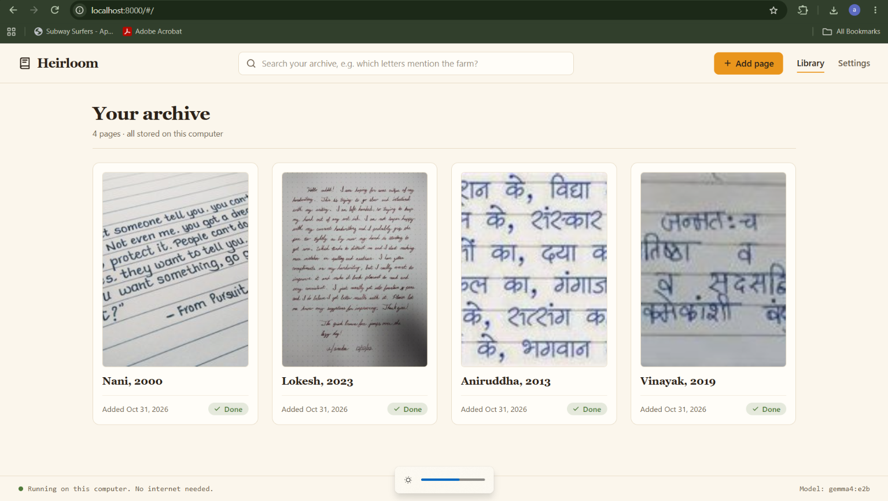
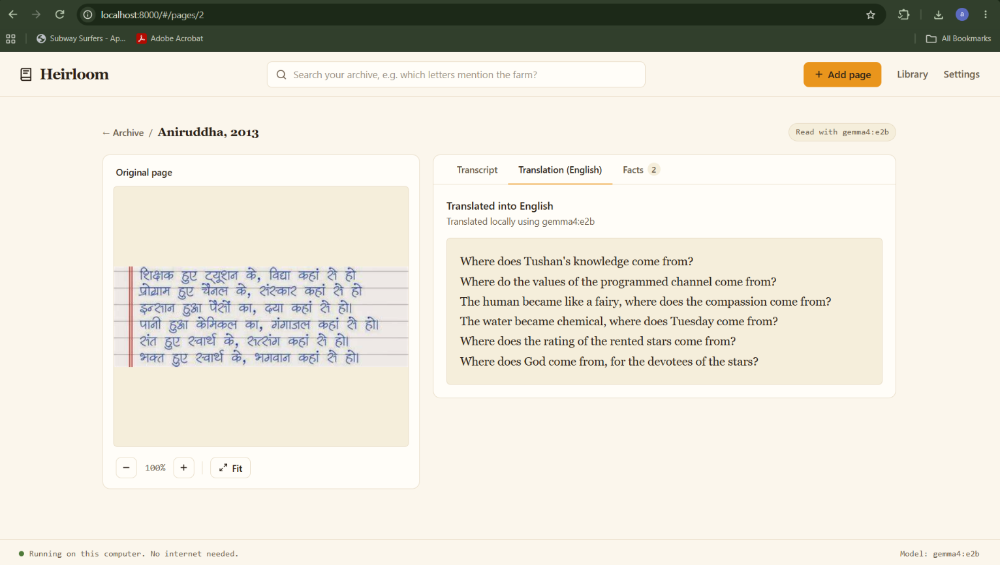
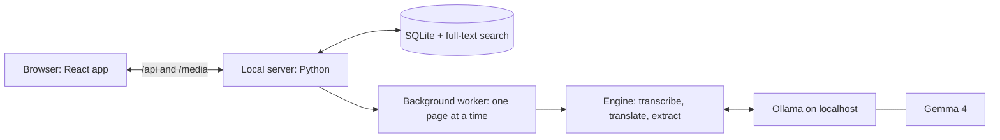

# Heirloom

**Read your family's handwritten letters, privately, on your own computer.**

Heirloom turns photos of old handwritten family documents into text you can read, correct, translate and search. It runs entirely on your laptop with an open-weight model ([Gemma 4](https://ai.google.dev/gemma) through [Ollama](https://ollama.com)). No account, no cloud, no internet needed.

> Built for the **DEV x MLH Hacktoberfest Open-Source AI Challenge, Week 4: "Ghost in the Machine"**.
> Category: **Best Use of Gemma**. Theme: honoring the past, in the spirit of Día de los Muertos.

| | |
|---|---|
| DEV post | TODO_POST_URL |
| Demo video | TODO_VIDEO_URL |
| Tags | `#devchallenge` `#hf26challenge` |

<!-- Screenshots: capture these from the running app and save them in docs/screenshots/ -->



*The screenshots show sample pages that ship with the project. They are generated images, not real family scans.*

---

## Why we built it

Many families hold letters, diaries and ledgers written by hand, often in a language or script that younger relatives cannot read. The people who could read them are getting older. The pages sit in a trunk, and each year they are a little harder to decipher.

Sending those pages to a cloud service means handing someone else your family's private history, and paying per page. Heirloom keeps everything on one computer. A keeper photographs a page, and Heirloom reads it, shows the original beside the transcript, lets a person fix any word the model got wrong, translates it, and pulls out the people, places, dates and objects it mentions.

It is a small way to keep the voices of people who are gone from fading with them.

## What it does

- **Reads handwriting.** Upload a JPG or PNG. A local Gemma 4 vision model transcribes it.
- **Original beside the transcript.** Zoom (50 to 300%) and pan the photo while you read the text.
- **Click any word to correct it.** Corrections are saved with their date and always win. Words the model marks as unsure are highlighted when it does.
- **Translation.** Translate into English, Hindi, Marathi or Spanish. After you correct words, press **Refresh** to re-run translation and extraction from the fixed text.
- **Facts.** People, places, dates and items are pulled out as chips. Click one to see where it appears and jump to it in the transcript.
- **Search the whole archive.** Matches across transcripts, translations and facts, with a snippet and a thumbnail. Corrected text is what gets searched.
- **Pick your own model.** The Settings screen lists the models you have installed in Ollama. Changing it only affects pages you add afterwards.
- **Works with the Wi-Fi off.** After the one-time model download, nothing needs the internet.

## Why open models matter here

The challenge asks where an open approach works better than a closed one. For this project:

- **Privacy.** Family letters never leave the machine. There is no server we control and no account.
- **It works with the lights off.** Run it on a laptop with no connection. Useful when the archive and the keeper are in a place with poor internet.
- **No cost per page.** An archive of hundreds of pages costs nothing to read.
- **It will not disappear.** There is no service to shut down. The model, the data and the code are all files on your computer, and you can back them up by copying a folder.
- **You can swap models.** The model is a setting, not a contract. Try `gemma4:e4b`, or any vision model Ollama supports.

We are honest about the trade-off: a large hosted model would likely read difficult handwriting better. We chose a small local model because privacy and ownership matter more for this kind of archive, and because we built a correction loop so a person can fix what the model misses.

## How it works



1. You upload a photo. The server stores the original untouched and queues the page.
2. A background worker processes **one page at a time**, so small laptops are not overloaded: `transcribing`, then `translating`, then `extracting`, then `done`.
3. **Transcribe.** The image is rotated by its EXIF tag, converted to RGB and shrunk to at most 1280 px. The model is asked for a faithful transcription and to mark unreadable words. Repeated lines are trimmed.
4. **Translate.** Only the transcript is translated, and names are kept as written.
5. **Extract.** The model lists people, places, dates and items as JSON. The model is never asked for positions. Our code finds each value in the transcript, drops anything that is not in the text, and removes junk, so every highlight points at real text.
6. Corrections replace the exact characters you pick. Refresh re-runs steps 4 and 5 from the corrected text.

Every request uses `num_ctx=4096` and `temperature=0`, so it fits on a 6 GB laptop GPU and gives repeatable results.

## Quick start (Windows)

**You need:**
- Windows with **Python 3.11**
- [Ollama](https://ollama.com), installed and running
- About 5 GB of disk for the default model
- Node.js is **not** needed, because the built web app is included in `frontend/dist`

```powershell
git clone https://github.com/VinayakGawade009/Heirloom
cd Heirloom

# one time: download the model (about 4.6 GB)
ollama pull gemma4:e2b

pip install -r backend\requirements.txt
.\start.bat real
```

`start.bat real` opens **http://localhost:8000**. Add a photo of a handwritten page with **Add page**.

The first page after Ollama starts takes about 20 seconds longer while the model loads.

**Just want to look around?** Run `.\start.bat` with no argument. It uses a stub engine with canned results and needs no model. To add three sample pages to an empty archive:

```powershell
cd backend
python -m app.seed            # add samples if the archive is empty
python -m app.seed --reset    # wipe the archive, then add samples
```

**To check that it is offline:** turn Wi-Fi off, run `.\start.bat real`, and open the browser's Network tab. Every request goes to `localhost`.

## Speed and hardware

Measured on an ASUS laptop with an RTX 4050 (6 GB), `gemma4:e2b`, model already loaded. Time is for all three steps together.

| Page | Time per page |
| --- | --- |
| Neat English | about 20 to 22 s |
| Catalan | about 32 to 41 s |
| Marathi | about 36 to 72 s |

- `gemma4:e2b` uses about 3.2 GB of the 6 GB GPU, fully on the GPU.
- `gemma4:e4b` (6.6 GB) read one Catalan page slightly better, but took 45 to 168 s per page and was less stable on 6 GB, so it is not the default.
- Keep other GPU programs closed while processing, and do not switch models mid-session.

## Honest limits

We would rather you know before you try it.

- **The small model almost never marks words it cannot read,** so the "unsure" highlights are rare. That is why you can click **any** word to correct it.
- **Handwriting quality varies.** Neat English reads well. Catalan and Marathi pages come out partly wrong, and one Marathi page gave different text between runs.
- **A misread word carries into the translation** until you correct it and press Refresh. For example, "roja" translated as "redhead", while "rosa" gave "rose".
- **Facts can be empty** on pages with no names, places or dates.
- **Ollama's model runner crashed** (status 500) a few times during testing. If a page fails with `model_failed`, quit Ollama completely, start it again, wait about 10 seconds and retry.
- Windows is the tested platform.

## Troubleshooting

| Problem | Fix |
| --- | --- |
| `start.bat is not recognized` | In PowerShell, use `.\start.bat` |
| `only one usage of each socket address` | Another copy of the server is running on port 8000. Close it and start again |
| Settings shows "Ollama not running" | Start the Ollama app, then reload |
| A page ends in `model_not_installed` | Run `ollama pull gemma4:e2b`, or the model named in Settings |
| A page stays on "transcribing" for a long time | The first page after Ollama starts is slow, and large photos are slower. Check the server window for errors |
| Page images look wrong after a reset | Press Ctrl+F5 |
| `pip` fails with an SSL certificate error | Download the packages first, then install from the folder: `py -3.11 -m pip download --dest wheels -r backend\requirements.txt`, then `pip install --no-index --find-links wheels -r backend\requirements.txt` |

More detail is in [`backend/README.md`](backend/README.md).

## Project layout

```
Heirloom/
  start.bat                 one command to run everything
  backend/
    requirements.txt
    app/
      main.py               routes, and serving the web app and page images
      service.py            pages, worker, corrections, refresh, search
      db.py                 SQLite tables and the full-text search table
      engine/               the model steps: transcribe, translate, extract
      engine_loader.py      chooses the real or the stub engine
      engine_stub.py        canned engine for testing
      seed.py               sample pages
    data/                   created at run time, ignored by git
  frontend/                 React web app (the built app is in frontend/dist)
  docs/
    api-contract.md         the API shared by the three parts
    model-notes.md          what we learned about the models
    design-reference/       the design reference screens
  samples/                  sample page images
```

## Built with

- **Model:** Gemma 4 (`gemma4:e2b` by default) through Ollama
- **Server:** Python, with SQLite and its FTS5 full-text search
- **Web app:** React, Vite, TypeScript and Tailwind CSS (v3.4). Fonts and icons are bundled, so there are no CDN or remote-font requests. `npm run check:offline` fails the build if any source file contains a remote URL.
- **Interface design:** drafted in Google Stitch, then built in code. The look is warm paper tones with marigold accents, a nod to the marigolds of Día de los Muertos.
- **Tooling:** the frontend was built with the help of AI coding agents (Google Antigravity), and we reviewed and tested what they produced.

## Developing

**Web app** (needs Node.js):

```powershell
cd frontend
npm ci
npm run dev            # runs against a built-in mock API (VITE_USE_MOCK=true)
```

To use the real server while developing, start it with `.\start.bat` and create `frontend/.env.development.local` containing `VITE_USE_MOCK=false`. The dev server proxies `/api` and `/media` to `http://localhost:8000`.

After changing the web app, rebuild and commit the built files (`dist` is git-ignored by default, so it needs `-f`):

```powershell
npm run build
npm run check:offline
cd ..
git add -f frontend/dist
```

**Engine from the command line** (from the `backend` folder):

```powershell
python -m app.engine.try path\to\page.jpg --hint Marathi --language English --model gemma4:e2b
```

It prints the transcript, unsure spans, translation, facts and the seconds each step took.

**Environment variables:** `HEIRLOOM_ENGINE` (`real` uses the real engine, anything else uses the stub), `HEIRLOOM_DATA_DIR` (where the database and images live, default `backend/data`), `HEIRLOOM_STUB_DELAY` (seconds each stub step waits).

**API:** all routes start with `/api`. The full contract is in [`docs/api-contract.md`](docs/api-contract.md).

## Your data

Everything is under `backend/data`. To back up the archive, copy that folder. To start from nothing, stop the server and delete it. Original images are never modified.

## Team

| Role | Who | DEV |
| --- | --- | --- |
| Frontend, docs, demo and post | Vinayak Gawade | [@vinayakgawade](https://dev.to/vinayakgawade) |
| Engine (transcribe, translate, extract) | Arushi | [@arushigulbhile](https://dev.to/arushigulbhile) |
| Archive (server, database, search, start script) | Aniruddha | [@aniruddhashirsat](https://dev.to/aniruddhashirsat) |

## Challenge submission

- **Challenge:** Hacktoberfest Open-Source AI Challenge, Week 4, "Ghost in the Machine"
- **Partner category:** Best Use of Gemma. Gemma 4 runs locally through Ollama and is the only model in the project.
- **Deadline:** 11:59 PM PDT on 31 Oct 2026 (12:29 PM IST on 1 Nov 2026).
- **Commits after the deadline:** none.

## License

Released under the [MIT License](LICENSE).
